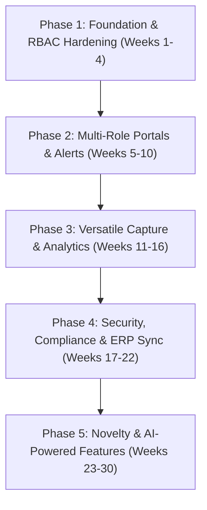

# Attendance Tracker — Feature Audit & Comprehensive Implementation Roadmap

## 1. Executive Summary & Audit Overview

This document presents a comprehensive feature audit, gap analysis, and phased implementation roadmap for the Attendance Tracking System. The evaluation assesses user-specific needs across all stakeholders (Students, Teachers, Parents, Administrators), core application capabilities, security/compliance mandates, and high-impact novelty features.

---

## 2. Feature Audit & Gap Analysis

### 2.1 User-Specific Portals & Needs

| Stakeholder | Required Capability | Current/Standard State | Gap Severity | Action Plan |
| :--- | :--- | :--- | :--- | :--- |
| **Students** | Self-service attendance history | Basic list view | Low | Upgrade to graphical breakdown (subject-wise) |
| | Percentage tracking & shortage warnings | Missing / Basic | **High** | Implement live percentage calculation with color-coded shortage threshold warnings |
| | Frictionless check-in (Dynamic QR / RFID) | Missing | **Critical** | Dynamic expiring QR code scanning and RFID/NFC card support |
| **Teachers** | Non-disruptive digital attendance marking | Standard list check | Medium | Add 1-tap bulk marking, quick toggle gestures |
| | Class-wide trends & late arrival tracking | Missing | **High** | Introduce 3-state attendance (`Present`, `Late`, `Absent`) + analytics dashboard |
| | Automated leave request approval workflow | Missing | **High** | Leave request submission, teacher review dashboard, auto-updating records |
| **Parents** | Dedicated parent portal | Missing | **Critical** | Separate role portal with multi-child switcher & attendance calendar |
| | Real-time automated alerts (SMS/Push/Email) | Missing | **Critical** | Trigger push/SMS instant notification upon absence or tardiness |
| **Administrators** | Campus-wide centralized interactive dashboard | Missing | **High** | High-level metrics, department drill-downs, live attendance trends |
| | Automated compliance reports (PDF/Excel) | Missing | **High** | Scheduled & on-demand exports for accreditation and audits |
| | Predictive analytics for at-risk student intervention | Missing | **High** | Trajectory modeling to flag students heading toward academic probation |

---

### 2.2 Core Application Features

| Capability | Requirement | Status | Priority | Implementation Strategy |
| :--- | :--- | :--- | :--- | :--- |
| **Versatile Capture Methods** | Dynamic QR Scanning | Missing | Phase 3 | 60s rotating cryptographic token (`mobile_scanner`, `qr_flutter`) |
| | Biometrics (Face/Fingerprint) | Missing | Phase 3 | On-device ML Kit Face Mesh / Biometric Auth; secure vector storage |
| | RFID / Smart Cards | Missing | Phase 3 | NFC smart card reading via `flutter_nfc_kit` |
| | GPS / Geofencing | Missing | Phase 3 | Geo-boundary validation for field trips & campus perimeter (`geolocator`) |
| **Automated Notifications** | Parent alerts on unexcused absence | Missing | Phase 2 | Cloud Functions triggered on Firestore record write + Firebase Cloud Messaging (FCM) / Twilio |
| | Admin threshold breach alerts | Missing | Phase 2 | Background trigger when student attendance drops below critical percentage (e.g. 75%) |
| **Advanced Analytics** | Daily / Monthly / Subject-wise reports | Missing | Phase 3 | PDF & Excel generation engines (`pdf`, `excel`) |
| | Predictive early warning model | Missing | Phase 3 | Rolling trend analysis & regression models for dropout prevention |
| **System Integration** | LMS (Google Classroom, Canvas, Moodle) | Missing | Phase 4 | OAuth2 sync for course rosters and gradebook attendance columns |
| | SIS / ERP Connector | Missing | Phase 4 | Secure REST/Webhook bridge with JSON payloads |

---

### 2.3 Security, Privacy & Compliance

| Challenge | Requirement | Target Architecture |
| :--- | :--- | :--- |
| **Data Privacy (FERPA / GDPR)** | Explicit consent workflows, privacy notices, data export/deletion rights | First-login consent dialog, audit-compliant GDPR Art. 17 data purge mechanism |
| **Biometric Data Protection** | Secure processing of facial/fingerprint data without raw image persistence | On-device embedding extraction; AES-256 encrypted vector storage; zero raw image retention |
| **Data Protection** | Encryption at rest and in transit | HTTPS/TLS 1.3 enforced, certificate pinning, Firestore native at-rest encryption |
| **Access Control (RBAC)** | Role-segregated views (`student`, `teacher`, `parent`, `admin`) | Fine-grained Firestore Security Rules & JWT custom claims |
| **Audit Trails** | Immutable historical record of manual alterations | Write-only audit log collection in Firestore; modifications require reason logging |

---

## 3. High-Value Novelty Features (Competitive Differentiators)

1. **Gamified Attendance Streaks & Badges**
   - Rewards punctuality and consistent attendance with streak counters, milestones, and unlockable student profile badges.
2. **Interactive Smart Seating Chart**
   - Visual drag-and-drop classroom layout allowing teachers to tap physical desk locations to mark or verify presence.
3. **Peer-Proxy & Buddy-Punching Detection**
   - Heuristic anomaly engine checking device fingerprint, Bluetooth BLE beacons, and identical IP/GPS timestamps to detect attendance spoofing.
4. **Student Wellness & Pulse Check-in**
   - Optional, confidential 1-tap mood/wellness pulse during check-in, giving counselors early signals on student disengagement.
5. **Digital Timed Hall Pass**
   - Integrated QR-based temporary checkout (library, nurse, restroom) updating classroom status to "Temporarily Away" with duration limits.
6. **AI Narrative & Predictive Insights (Gemini API)**
   - Generative summaries for administrators and counselors explaining absenteeism drivers (weather correlation, day-of-week patterns, exam stress).
7. **Parent-Teacher Contextual Absence Chat**
   - In-app threaded communication attached directly to a specific absence incident, eliminating disconnected emails and phone calls.

---

## 4. Phased Implementation Roadmap

---

### 🔹 Phase 1: Foundation, RBAC & Core Data Models (Weeks 1–4)
*Objective: Solidify backend architecture, role boundaries, and fundamental tracking metrics.*

- [ ] **Role-Based Access Control (RBAC):** Configure Firebase Custom Claims and Firestore Rules for `Student`, `Teacher`, `Parent`, and `Admin`.
- [ ] **3-State Attendance Model:** Refactor schema to support `Present`, `Absent`, and `Late` (with late minute tracking).
- [ ] **Shortage Calculation Service:** Engine calculating cumulative & subject-wise percentage vs. institution threshold (e.g., 75%).
- [ ] **Immutable Audit Log System:** Centralized logging for any manual attendance record edit (stores user ID, timestamp, old value, new value, reason).
- [ ] **Offline Cache & Sync Queue:** Local persistence via Hive/Isar with conflict-free replay on network reconnect.

---

### 🔹 Phase 2: Role-Dedicated Portals & Real-Time Alerts (Weeks 5–10)
*Objective: Deliver tailored interfaces for all 4 user roles with instant push/SMS channels.*

- [ ] **Parent Portal & Multi-Child Switcher:** Dedicated dashboard with daily status, calendar view, emergency contact button.
- [ ] **Real-Time Notification Pipeline:** Cloud Function + FCM push alerts & Twilio SMS fallback for unexcused absences.
- [ ] **Student Self-Service Portal:** Interactive graphs (`fl_chart`), standing widget, low-attendance warning banners.
- [ ] **Leave Request & Approval Engine:** Student/parent leave submission with medical note attachment; teacher 1-click review inbox.
- [ ] **Teacher Efficiency Tools:** 1-tap bulk attendance marking ("Mark All Present") with fast exception toggling.

---

### 🔹 Phase 3: Versatile Capture Methods & Advanced Analytics (Weeks 11–16)
*Objective: Eliminate manual roll-call friction with hardware & biometric inputs, plus reporting.*

- [ ] **Dynamic QR Code Check-In:** Teacher screen projects dynamic QR code refreshing every 30–60s with encrypted payload.
- [ ] **Geofencing & GPS Verification:** Campus boundary validation using `geolocator`.
- [ ] **RFID / NFC Integration:** Tap-to-check-in functionality using `flutter_nfc_kit`.
- [ ] **Biometric Enclave Integration:** Device biometric auth (Face ID / Fingerprint) and ML Kit on-device face verification.
- [ ] **Automated Reporting Suite:** Scheduled/exportable PDF & Excel reports (`pdf`, `excel`).
- [ ] **Predictive At-Risk Engine:** Algorithmic evaluation of consecutive absences and negative trends for early intervention.

---

### 🔹 Phase 4: Compliance, Enterprise Security & Integrations (Weeks 17–22)
*Objective: Attain institutional grade compliance, encryption standards, and enterprise SIS interoperability.*

- [ ] **FERPA / GDPR Compliance Suite:** First-time user consent workflows, data export archives, parental consent management.
- [ ] **Biometric Encryption Pipeline:** AES-256 encryption for mathematical face embeddings; zero raw image retention.
- [ ] **Transport Security & Certificate Pinning:** Secure TLS 1.3 channel enforcement and SSL certificate pinning.
- [ ] **LMS Integrations:** Two-way sync adapters for Google Classroom and Canvas LMS APIs.
- [ ] **SIS/ERP Connectors & Webhooks:** RESTful webhook dispatcher for SIS/ERP databases.

---

### 🔹 Phase 5: Novelty Features & AI Capabilities (Weeks 23–30)
*Objective: Deploy market-leading innovations and generative intelligence.*

- [ ] **Gamification Engine:** Punctuality badges, attendance streaks, and milestone rewards.
- [ ] **Interactive Visual Seating Map:** Visual classroom grid where teachers map students to seats and mark attendance visually.
- [ ] **Anti-Proxy / Buddy-Punching Guard:** Detection heuristics monitoring duplicate device IDs and suspicious check-in clusters.
- [ ] **Student Wellness Pulse Check:** Optional emotional pulse question on check-in feeding anonymized wellness dashboards.
- [ ] **Digital Timed Hall Pass:** Dynamic QR hall pass for temporary exits with real-time room occupancy tracking.
- [ ] **Gemini-Powered Predictive & Narrative Analytics:** Automated weekly executive summaries highlighting attendance bottlenecks.
- [ ] **Contextual Parent-Teacher Messaging:** In-app direct messaging linked directly to specific absence occurrences.

---

## 5. Technology Stack & Package Recommendations

| Functionality | Recommended Dart / Flutter Package |
| :--- | :--- |
| **Data Visualizations** | `fl_chart: ^0.68.0` |
| **Push Notifications** | `firebase_messaging: ^15.0.0`, `flutter_local_notifications: ^17.0.0` |
| **QR Code Engine** | `mobile_scanner: ^5.0.0`, `qr_flutter: ^4.1.0` |
| **Geolocation & Geofence**| `geolocator: ^12.0.0` |
| **NFC / RFID Cards** | `flutter_nfc_kit: ^3.3.0` |
| **Document Exporting** | `pdf: ^3.10.0`, `excel: ^4.0.0`, `path_provider: ^2.1.0` |
| **Biometric Authentication**| `local_auth: ^2.2.0`, `google_mlkit_face_detection: ^0.11.0` |
| **Local Offline Cache** | `hive: ^2.2.3` or `isar: ^3.1.0` |
| **AI Insights** | `google_generative_ai: ^0.4.0` |

